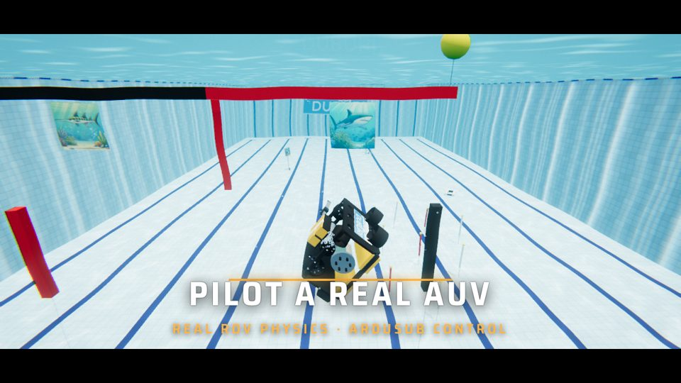
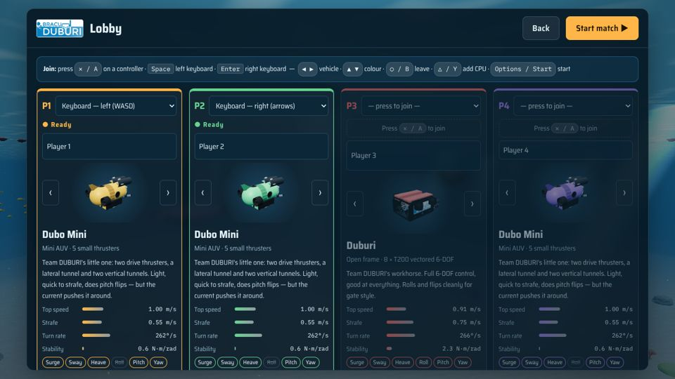
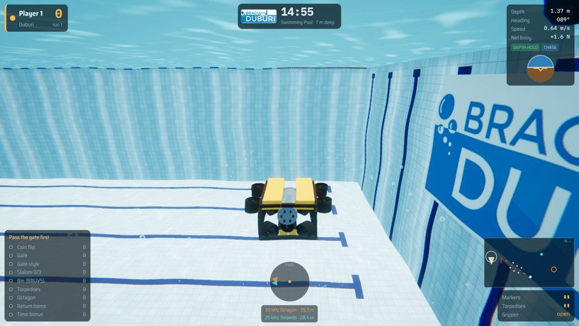
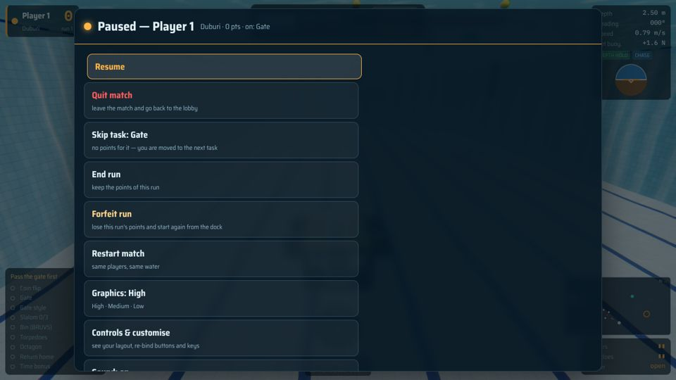
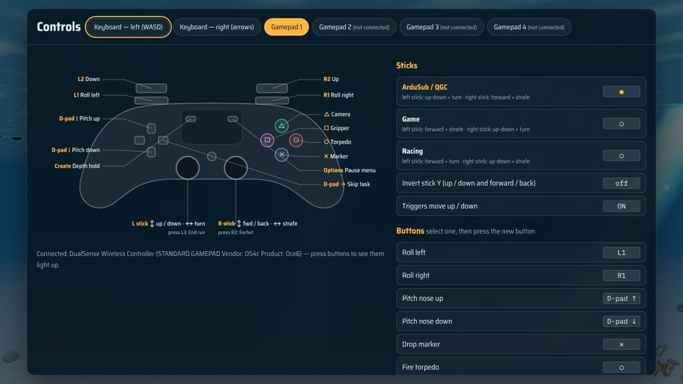
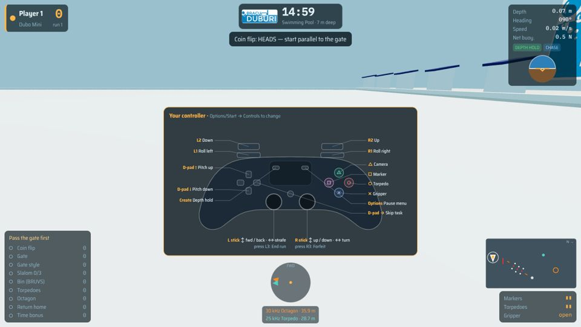

# Life as Duburi


**Life as Duburi** is an underwater robotics game by **Team BRACU DUBURI**. You are an
autonomous underwater vehicle on a real AUV-competition course: pass the gate, run the slalom,
drop markers in the bin, fire torpedoes through a board, clean up trash at the octagon and
come home. 1 to 4 players in the same water on one screen — PS5-couch style split screen,
keyboards or gamepads, with optional CPU opponents.

The vehicles run on the **DUBURI ROV simulator**'s own physics: 6-DOF hydrodynamics,
Blue Robotics T200 / T500 thruster curves, ArduSub-style stabilise + depth hold, EOS-80 sea
water. The physics modules in `src/physics`, `src/alloc`, `src/core` and `src/hydro` come
unchanged from the [DUBURI simulator](https://github.com/jarifalamclaude-max/simulator).

## ▶ Play

* **Offline, no install:** download [`dist/life-as-duburi.html`](dist/life-as-duburi.html) and
  double-click it. Everything (code, textures, logo, sound) is inside that one file.
* **On GitHub Pages:** in *Settings → Pages* choose branch `main`, folder `/docs`; the game is
  then at `https://jarifalamclaude-max.github.io/LIFE_AS_DUBURI/`.

Chrome, Edge or Firefox with WebGL2. Gamepads (PlayStation / Xbox) work in Chrome and Edge.
If a laptop struggles, set *Graphics* to Medium or Low in the pause menu.

## Promo video

[](promo/life-as-duburi-promo.mp4)

[▶ Watch the 40-second promo](promo/life-as-duburi-promo.mp4) — recorded frame by frame from the game
itself (CPU autopilots flying the course), with an original synthesised soundtrack.

## Join like on a console



Press **✕ / A** on a controller, **Space** (left keyboard) or **Enter** (right keyboard) to join.
Each player picks a vehicle with **◀ ▶** and a colour with **▲ ▼**, **Share / View** shows the
controller layout, **△ / Y** adds a CPU opponent, **Options / Start** starts the match. The screen splits by itself: one player full
screen, two side by side, three or four in quarters (with three, the fourth quarter is a TV
camera that follows the leader, with live standings).


## Vehicles

| Vehicle | Build | Character |
|---|---|---|
| **Duburi** | open frame, 8 × T200 vectored (BlueROV2 Heavy layout) | full 6-DOF, good at everything, clean rolls for gate style |
| **Dubo Mini** | mini AUV, **5** small thrusters: 2 drive, 1 lateral tunnel, 2 vertical tunnels | light and quick to strafe, does pitch flips, gets pushed by current |
| **Barracuda** | torpedo AUV, 5 × T200 | fastest (2 m/s) but turns slowly and cannot roll |
| **Kraken** | box frame, 6 × T500 | heavy, very stable, shrugs off current, no pitch control |
| **Manta** | flat wing, 8 × T200 | the stunt bot — rolls fast, a bit twitchy in waves |

Speeds, turn rates and controllable axes in the lobby are computed from each design's
thrusters and drag, not typed in.

## Water

| Swimming pool | Pacific Ocean | Arctic Ocean |
|---|---|---|
|  |  |  |
| 7 m deep, 26 °C fresh water, tiled pool | 12 m, 22 °C reef lagoon, sand and coral, swell | 15 m, −1.5 °C under the sea ice, marine snow |

Depth can also be set to 5–20 m in the lobby. The water is physical, not just a look: density
comes from temperature and salinity (EOS-80), so the same vehicle is ~3 % more buoyant in the
Arctic than in the pool, and current, turbulence and waves really push you around.

## Graphics and sound

* Post-processing on every split-screen view: bloom, underwater colour absorption that gets
  stronger with depth and murk, refraction wobble, vignette, chromatic aberration, film grain.
* Sun shadows, image-based reflections on metal and acrylic, caustics on the floor, god rays,
  thruster bubbles that rise and pop at the surface, marine snow, coral, fish, jellyfish and sea ice.
* Synthesised underwater sound: each thruster's blade-pass hum and motor whine follow its real
  rpm, prop wash and cavitation, muffled water acoustics with a dark room echo, bubbles and
  ambience, hydrophone pings from the pingers, splashes, thuds and gripper servos. Other
  vehicles are heard by distance and direction.
* Graphics quality High / Medium / Low in the pause menu.

## The tasks

| | Task | What to do |
|---|---|---|
| 0 | **Heading out** | Optional coin flip sets your start heading. Dive before leaving the start zone. |
| 1 | **Gate** | Pass under the reef-shark or sawfish side: that is *your* animal for the run. Roll / pitch / yaw quarter-turns in the gate zone score style. |
| 2 | **Slalom** | 3 sets of white / red / white pipes near the floor. Keep the red pipe on the same side as at the gate. |
| 3 | **Bin** | Drop 2 markers in the 12 × 24 in bin, in your animal's half (use the down camera). |
| 4 | **Torpedoes** | Fire 2 torpedoes through the 4 in openings, your animal first, from behind the 2 m line. |
| 5 | **Octagon** | Follow the 30 kHz pinger. Put the cup and spoon in their baskets, spin once per item, surface inside the octagon, face your animal. |
| 6 | **Return home** | Back through the gate under water. |

| Gate | Torpedo board | Bin (down camera) |
|---|---|---|
|  |  |  |

**Rules:** the gate must come first; surfacing anywhere except inside the octagon is a *breach*
and ends the run; the best run counts; a time bonus (100 points per minute left) needs gate +
bin or torpedo + octagon surface.

### Skip, forfeit, leave, quit



Next to the clock there are always two buttons: **⏸ Pause** and **✕ Quit match** (it asks
before quitting). Each player also has their own pause menu (**Options / Menu**, **Tab** or
**Backspace**; **Esc** for player 1), driven with their own controller:

* **Quit match** — the match ends and everyone goes back to the lobby.
* **Skip task** — no points for it; you are moved to the start of the next task.
* **End run** — stop here and keep the points.
* **Forfeit run** — lose this run's points and start again from the dock.
* **Leave match** — you drop out, the others keep playing and the screen re-splits.
* **Restart match** — same players, same water, from the start.

## Controls — see them, change them



Pick up a controller and the game shows you its layout: every player gets a card with *their*
controller (or keys) at the start of a match, and the **Controls** screen (title screen, lobby,
**Share / View** on a controller in the lobby, or *Controls & customise* in the pause menu)
draws the PlayStation or Xbox controller with what every button does — buttons light up live
as you press them.

Everything can be changed and is remembered in the browser, separately for each controller and
each keyboard side:

* **Buttons / keys:** select an action and press the new button or key; one already in use is
  swapped.
* **Sticks:** ArduSub / QGC (left: up-down + turn, right: forward + strafe), Game (left:
  forward + strafe, right: up-down + turn) or Racing (left: forward + turn, right: up-down +
  strafe); invert Y; triggers for up / down on or off.
* **Reset** brings back the defaults.



Defaults:

| | Keyboard left | Keyboard right | Gamepad (PS / Xbox) |
|---|---|---|---|
| Forward / back | W / S | ↑ / ↓ | right stick ↕ |
| Turn | A / D | ← / → | left stick ↔ |
| Strafe | Q / E | J / L | right stick ↔ |
| Up / down | R / F | I / K | left stick ↕, L2 / R2 |
| Roll / pitch (style) | Z X / T G | U O / Y H | L1 R1 / D-pad ↑ ↓ |
| Drop marker / fire torpedo / gripper | V / B / C | N / M / , | ✕ A / ○ B / □ X |
| Camera (chase → front → down) | 1 | 7 | △ Y |
| Depth hold on / off | 2 | 8 | Create / View |
| End run / forfeit / skip task | 3 / 4 / 5 | 9 / 0 / − | L3 / R3 / D-pad → |
| Pause menu | Tab or Esc | Backspace | Options / Menu |

Hold Shift for fine control. The HUD shows depth, heading, speed, net buoyancy, an attitude
ball, the hydrophone ring pointing at the 30 kHz (octagon) and 25 kHz (torpedo) pingers, a
mini-map and your task list.


## Develop

```bash
npm install
npm run build      # -> dist/life-as-duburi.html and docs/index.html
npm test           # headless: physics, rules, skip / forfeit / leave, full CPU runs in every water
npm run e2e        # browser tests with screenshots, incl. a simulated DualSense (needs Playwright + Chromium)
```

```
src/
  main.js       entry: renderer, split screen, pause menus, game loop
  sim/          vehicles, course layout, task judging, autopilot (no graphics, runs in node)
  render/       scenery, course elements, vehicle models, post-processing, bubbles, shadows
  ui/           lobby and menus, HUD, keyboard / gamepad input and re-binding, controls screen, sound engine
  physics/ alloc/ core/ hydro/   from the DUBURI simulator: water, thrusters, allocation, maths
assets/         DUBURI logo and the task pictures
tests/          node tests + browser test
dist/           the built game (one HTML file)
docs/           the same file for GitHub Pages
screenshots/    pictures for this README
```

## What each file does

### Top level

| File | What it is for |
|---|---|
| `README.md` | This guide. |
| `LICENSE` | GPL-3.0-or-later licence. |
| `package.json` / `package-lock.json` | npm project: dependencies (three.js, esbuild) and the `build`, `test` and `e2e` scripts. |
| `build.mjs` | Build script: bundles `src/` with esbuild and inlines the CSS, images and code into one HTML file. |
| `.gitignore` | Files git ignores (`node_modules/`, test output). |
| `dist/life-as-duburi.html` | **The built game** in one file. Download and double-click to play offline. |
| `docs/index.html` | The same built game, served by GitHub Pages. |
| `docs/.nojekyll` | Tells GitHub Pages to serve the file as it is. |

### `assets/` — pictures packed into the game

| File | What it is for |
|---|---|
| `logo.jpg` | BRACU DUBURI logo: title screen, HUD, dock sign, pool banners, Duburi bot side plates. |
| `shark.jpg`, `sawfish.jpg` | Animal prints hanging on the gate and the octagon. |
| `bin-shark.jpg`, `bin-sawfish.jpg` | The two halves inside the bin; also the "chosen animal" icon on the HUD. |
| `board-shark-top.jpg`, `board-sawfish-top.jpg` | The two versions of the torpedo board picture. |

### `src/` — the game code

| File | What it is for |
|---|---|
| `main.js` | Entry point. Creates the renderer, runs the game loop (120 Hz physics, interpolated drawing), splits the screen per player, handles the pause menus, the controls screen and re-binding, results, bubbles, sound and the TV camera. |

**`src/sim/` — game logic (no graphics; also runs in node for the tests)**

| File | What it is for |
|---|---|
| `game.js` | One match: clock, players, runs, markers / torpedoes / trash, and the judging of every task and rule (gate first, breach, skip, forfeit, leave, time bonus). Point values are in `POINTS`. |
| `vehicle.js` | Vehicle physics (6-DOF body in water, buoyancy, drag, thrusters) and the pilot loop (stabilise, depth hold, roll / pitch flips). |
| `bots.js` | The five vehicles: Duburi, Dubo Mini, Barracuda, Kraken, Manta — mass, size, drag, thruster layout. |
| `course.js` | Where every course element is (gate, path markers, slalom, bin, torpedo board, octagon, pingers, dock) and its sizes. |
| `collide.js` | Collisions of vehicles with the course, the floor, the walls and each other. |
| `scenarios.js` | The three waters (pool, Pacific, Arctic): temperature, salinity, current, waves, depth, colours. |
| `autopilot.js` | CPU opponent: flies the whole course with the same controls a player uses. |
| `stats.js` | Speed, turn rate, axes and buoyancy shown in the lobby, worked out from the physics. |

**`src/render/` — 3D graphics (three.js)**

| File | What it is for |
|---|---|
| `scenery.js` | The water world: surface and waves, floor and caustics, pool walls, coral, ice, fish, jellyfish, particles, light rays, fog. |
| `course3d.js` | 3D models of the course elements. |
| `bots3d.js` | 3D models of the five vehicles (spinning props, gripper, markers, torpedoes) and of the payload items. |
| `art.js` | Loads the animal pictures as textures. |
| `post.js` | Post-processing per split-screen view: bloom, underwater colour and wobble, vignette, grain, tone mapping. |
| `bubbles.js` | Bubble particles from thrusters, torpedoes, markers and splashes. |
| `graphics.js` | Graphics quality presets (High / Medium / Low), reflections and sun shadows. |

**`src/ui/` — menus, HUD, input, sound**

| File | What it is for |
|---|---|
| `menu.js` | Title screen, lobby (join, vehicle, colour, water, depth, clock), how-to-play, results table. |
| `hud.js` | In-game HUD per player: score, depth, heading, attitude ball, hydrophone, mini-map, task list, messages, controls card, leaderboard. |
| `input.js` | Keyboard and gamepad reading, default and saved button / key bindings, stick presets. |
| `controls.js` | Controls screen: the controller drawing, the list of bindings to change, and the start-of-match card. |
| `audio.js` | Synthesised sound: thrusters, underwater ambience, pingers, splashes, hits, menu sounds. |
| `style.css` | Look of all menus and the HUD. |

**From the DUBURI simulator (unchanged)**

| File | What it is for |
|---|---|
| `physics/environment.js` | The water body: pressure, density with depth, current, turbulence, waves. |
| `physics/thruster.js` | T200 / T500 / small thruster models: thrust curves, rotor lag, in-flow, ventilation. |
| `alloc/allocation.js`, `alloc/frames.js` | Thruster allocation (which thruster pushes how much for each move) and ArduSub frame layouts. |
| `hydro/water.js` | Sea-water density and viscosity (EOS-80). |
| `core/math.js`, `core/rng.js` | Maths helpers (vectors, quaternions, matrices) and a seeded random number generator. |

### `tests/`

| File | What it is for |
|---|---|
| `game.test.mjs` | Node tests (`npm test`): physics, buoyancy, rules, skip / forfeit / leave, depth, full CPU runs for every vehicle and water. |
| `e2e.mjs` | Browser test with screenshots: menus, all waters, 1–4 players, pause menu, lobby join, leave, forfeit. |
| `controls-e2e.mjs` | Browser test with a simulated DualSense: join, layout screen, button and key re-binding. |

### `promo/` — the promo video

| File | What it is for |
|---|---|
| `life-as-duburi-promo.mp4` | The 40-second promo video (1280×720, 30 fps). |
| `music.mp3` | Its soundtrack: an original 120 BPM track, synthesised by `music.py`. |
| `music.py` | Makes the soundtrack (Python + numpy): drums, bass, arpeggio, risers and impacts timed to the cuts. |
| `capture.mjs` | Records the video frame by frame from the built game (Playwright + Chromium) with the captions; the ffmpeg command to join frames and music is at its top. |

### `screenshots/`

Pictures used in this README.

## Credits

Team **BRACU DUBURI**, BRAC University. Built on the DUBURI ROV simulator. Task layout, sizes
and pictures follow the 2025 AUV-competition team handbook published by RoboNation. Licence:
GPL-3.0-or-later (see [LICENSE](LICENSE)).
