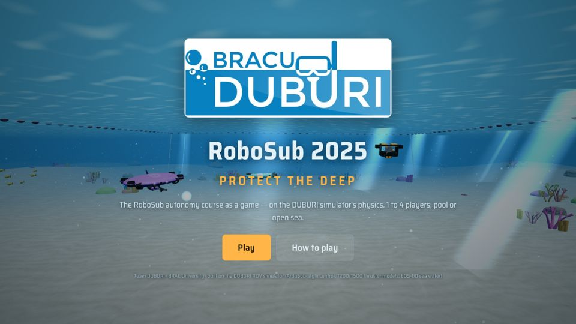
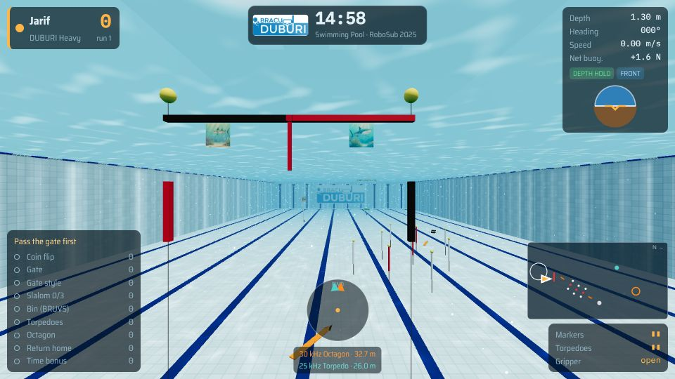
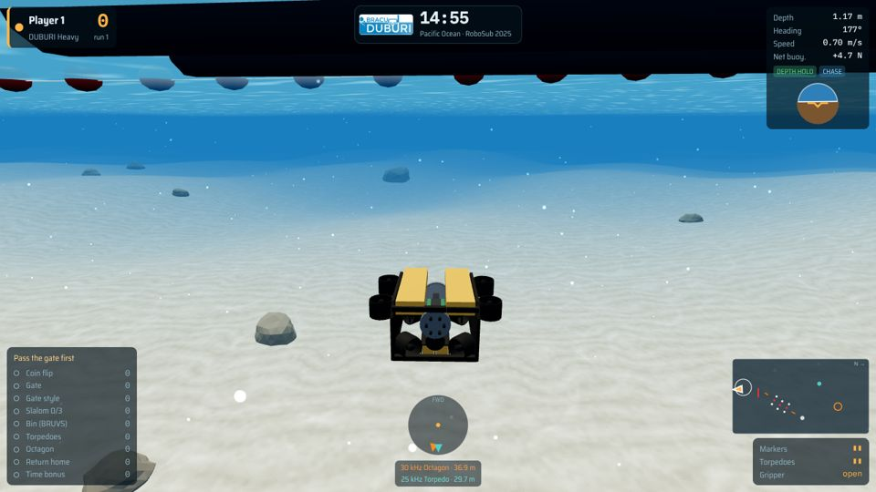
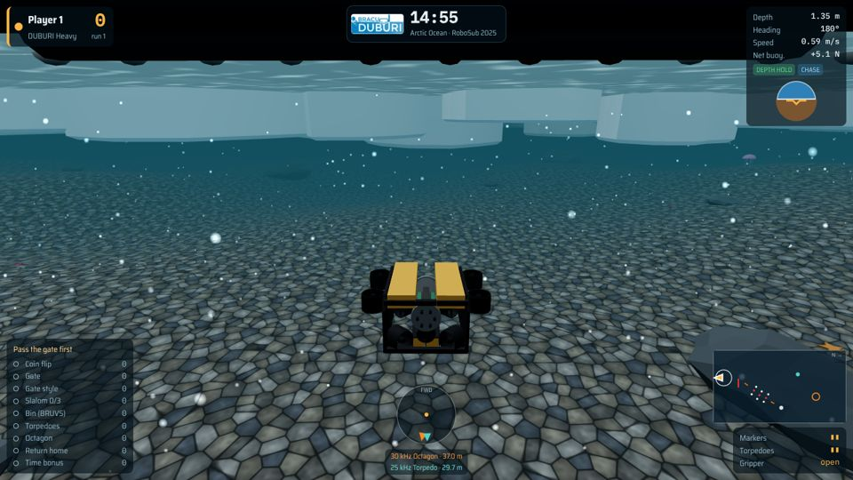
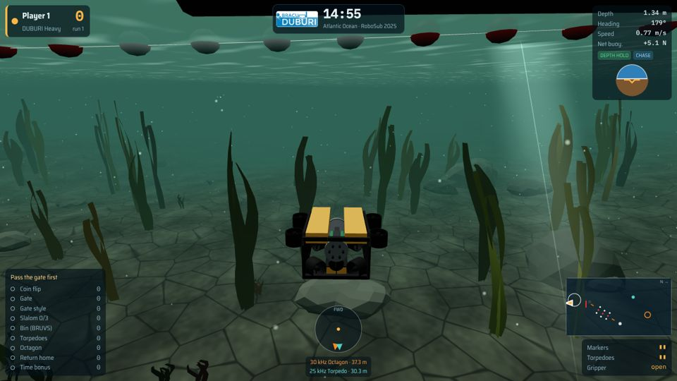
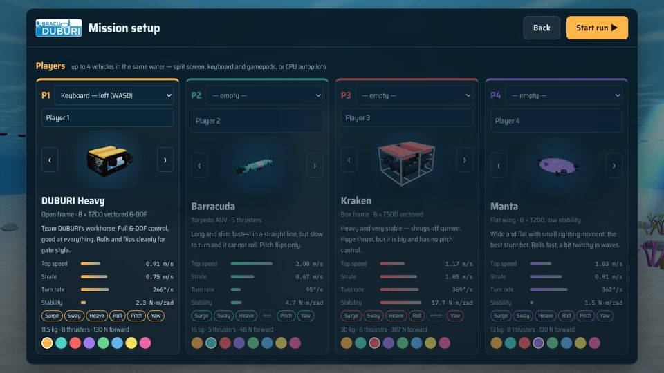
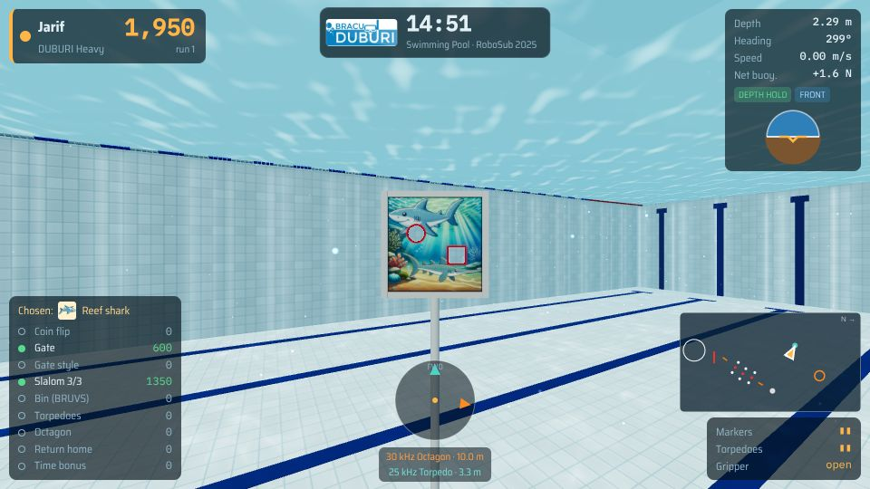
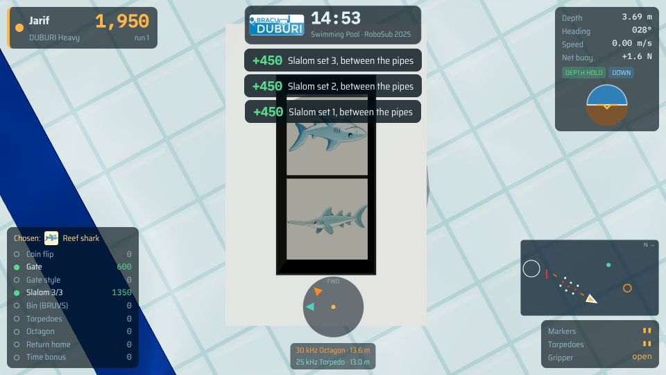
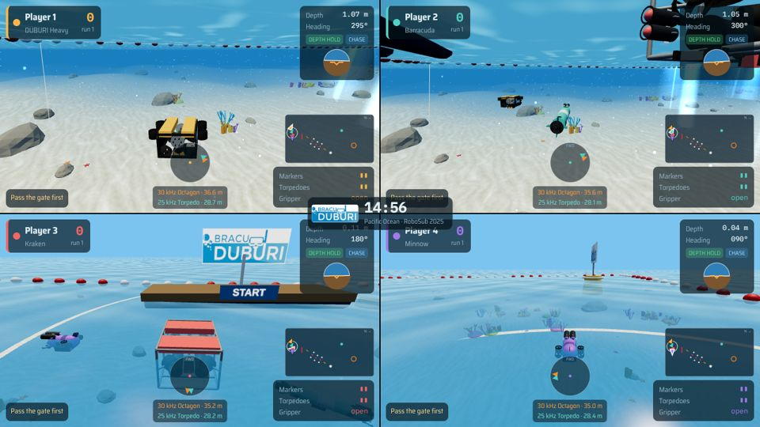
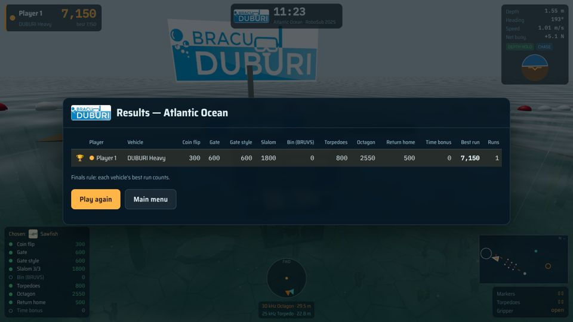

# LIFE AS DUBURI — RoboSub 2025 game



**RoboSub 2025 "Protect the Deep"** turned into a browser game for **Team BRACU DUBURI**.
Pick an AUV, dive into a pool or the open sea and do the real competition tasks — gate,
slalom, bin, torpedoes, octagon, return home — by the official team-handbook rules.
1 to 4 players in the same water, split screen, keyboard or gamepad, with optional CPU
opponents.

The vehicles are not cartoon physics: every bot runs on the **DUBURI ROV simulator**'s own
models (6-DOF hydrodynamics, Blue Robotics T200 / T500 thruster curves, ArduSub-style
stabilise + depth hold, EOS-80 sea water). The physics modules in `src/physics`, `src/alloc`,
`src/core` and `src/hydro` are taken unchanged from the
[DUBURI simulator](https://github.com/jarifalamclaude-max/simulator).

## ▶ Play

* **Offline, no install:** download [`dist/duburi-robosub.html`](dist/duburi-robosub.html) and
  double-click it. Everything (code, textures, logo) is inside that one file.
* **On GitHub Pages:** in *Settings → Pages* choose branch `main`, folder `/docs`; the game is
  then at `https://jarifalamclaude-max.github.io/LIFE_AS_DUBURI/`.

Chrome, Edge or Firefox with WebGL. A gamepad works in Chrome / Edge.

## Choose your water

| Swimming pool | Pacific Ocean | Arctic Ocean | Atlantic Ocean |
|---|---|---|---|
|  |  |  |  |
| 26 °C fresh water, tiled competition pool, no current | 22 °C reef lagoon, sand and coral, gentle swell | −1.5 °C under the sea ice, dim light, marine snow | 12 °C green murky water, kelp, 0.17 m/s current and chop |

The water is physical, not just a skin: density comes from temperature and salinity (EOS-80),
so the same vehicle is ~3 % more buoyant in the Arctic than in the pool, and current, turbulence
and waves really push you around.

## Choose your vehicle



| Vehicle | Build | Character |
|---|---|---|
| **DUBURI Heavy** | open frame, 8 × T200 vectored (BlueROV2 Heavy layout) | full 6-DOF, good at everything, clean rolls for gate style |
| **Barracuda** | torpedo AUV, 5 × T200 | fastest (2 m/s) but turns slowly and cannot roll |
| **Kraken** | box frame, 6 × T500 | heavy, very stable, shrugs off current, no pitch control |
| **Manta** | flat wing, 8 × T200 | the stunt bot — rolls fast, a bit twitchy in waves |
| **Minnow** | mini AUV, 6 small thrusters | tiny and agile, but slow and pushed by current |

Speeds, turn rates and controllable axes shown in the menu are computed from each design's
thrusters and drag, not typed in.

## The tasks (team handbook §3.2)

| | Task | What to do |
|---|---|---|
| 0 | **Heading out** | Optional coin flip sets your start heading. Dive before leaving the start zone. |
| 1 | **Collecting data — gate** | Pass under the reef-shark or sawfish side: that is *your* animal for the run. Roll / pitch / yaw quarter-turns in the gate zone score style. |
| 2 | **Navigate the channel — slalom** | 3 sets of white / red / white pipes. Keep the red pipe on the same side as at the gate. |
| 3 | **Drop a BRUVS — bin** | Drop 2 markers in the 12 × 24 in bin, in your animal's half (use the down camera). |
| 4 | **Tagging — torpedoes** | Fire 2 torpedoes through the 4 in openings, your animal first, from behind the 2 m line. |
| 5 | **Ocean cleanup — octagon** | Follow the 30 kHz pinger. Put the cup and spoon in their baskets, spin once per item, surface inside the octagon, face your animal. |
| 6 | **Return home** | Back through the gate under water. |

| Gate | Torpedo board | Bin (down camera) |
|---|---|---|
|  |  |  |

**Rules enforced like the real competition:** the gate must come first; surfacing anywhere
except inside the octagon is a *breach* and ends the run; starting a new run forfeits the
points; the best run counts; a time bonus (100 points per minute left) needs gate + bin or
torpedo + octagon surface. The handbook's official point table is "to be released", so the
point values are the game's own (keeping the handbook's order — roll/pitch style worth more than
yaw, your chosen animal worth more, the correct basket worth more).

Shark, sawfish, torpedo-board and bin pictures come from the RoboSub 2025 Team Handbook figures.

## Multiplayer



Up to 4 vehicles in the same water. Each seat can be *Keyboard left*, *Keyboard right*,
*Gamepad 1–4* or a *CPU autopilot*. Two, three or four viewports; with three players the
fourth quarter is a spectator camera. Vehicles bump into each other.



## Controls

| | Keyboard left | Keyboard right | Gamepad (ArduSub layout) |
|---|---|---|---|
| Forward / back | W / S | ↑ / ↓ | right stick ↕ |
| Turn | A / D | ← / → | left stick ↔ |
| Strafe | Q / E | J / L | right stick ↔ |
| Up / down | R / F | I / K | left stick ↕ (or triggers) |
| Roll / pitch (style) | Z X / T G | U O / Y H | LB RB / D-pad |
| Drop marker / fire torpedo / gripper | V / B / C | N / M / , | A / B / X |
| Camera (chase → front → down) | 1 | 7 | Y |
| Depth hold on / off | 2 | 8 | Back |
| End run (keep points) / new run | 3 / 4 | 9 / 0 | L3 / R3 |

Esc or Start pauses (rules and controls are in the pause menu). Hold Shift for fine control.
The HUD shows depth, heading, speed, net buoyancy, an attitude ball, the hydrophone ring
pointing at the 30 kHz (octagon) and 25 kHz (torpedo) pingers, a mini-map and your task list.

## Develop

```bash
npm install
npm run build      # -> dist/duburi-robosub.html and docs/index.html
npm test           # headless: physics, rules, full CPU runs in every water
npm run e2e        # browser smoke test with screenshots (needs Playwright + Chromium)
```

```
src/
  main.js       entry: renderer, split screen, game loop
  sim/          vehicles, course layout, task judging, autopilot (no graphics, runs in node)
  render/       three.js scenery, course elements, vehicle models
  ui/           menus, HUD, keyboard / gamepad input, sound
  physics/ alloc/ core/ hydro/   from the DUBURI simulator: water, thrusters, allocation, maths
assets/         DUBURI logo and the handbook pictures
tests/          node tests + browser smoke test
dist/           the built game (one HTML file)
docs/           the same file for GitHub Pages
screenshots/    pictures for this README
```

## Credits

Team **BRACU DUBURI**, BRAC University. Built on the DUBURI ROV simulator. Course and rules
from the RoboSub 2025 Team Handbook (RoboNation). Licence: GPL-3.0-or-later (see [LICENSE](LICENSE)).
